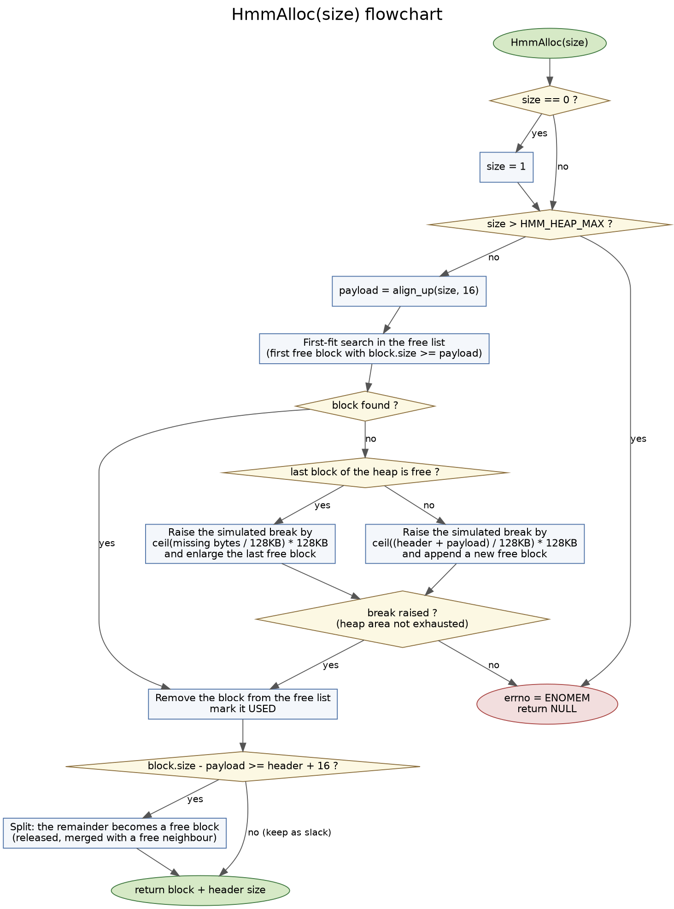
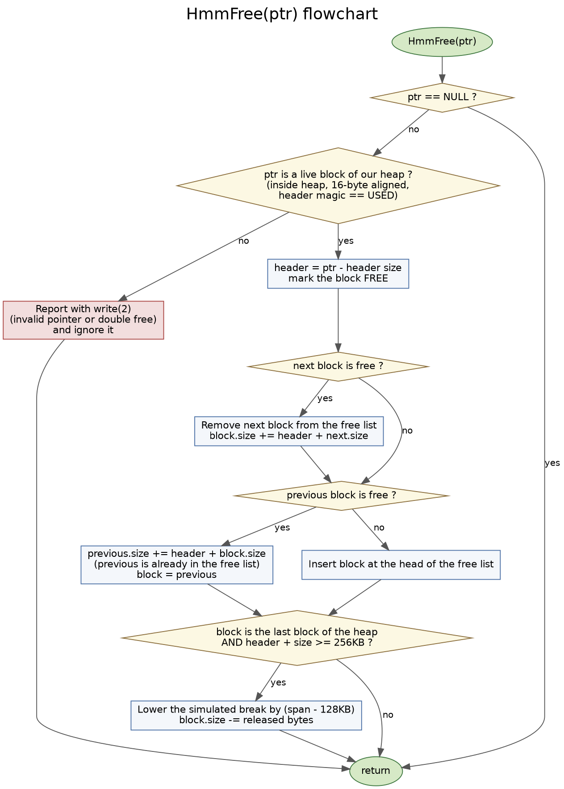

# HMM - Heap Memory Manager

A heap memory manager written in C for Linux. It provides the dynamic memory
allocation service (`malloc`, `free`, `calloc`, `realloc`) to user space
programs, using the real process program break through `sbrk()`.

```c
void *HmmAlloc(size_t size);                    // allocate `size` bytes
void  HmmFree(void *ptr);                       // free a pointer returned by HmmAlloc
void *hmmCalloc(size_t nmemb, size_t size);     // allocate zeroed array
void *hmmReAlloc(void *ptr, size_t reqSize);    // resize a block
size_t hmmSize(void *ptr);                      // usable size of a block
```

`src/heapWrappers.c` (unchanged) maps the standard names to these functions:
`malloc -> HmmAlloc`, `free -> HmmFree`, `calloc -> hmmCalloc`,
`realloc -> hmmReAlloc`.

---

## 1. Project layout

```
inc/Hmm.h               public API
inc/HmmInternal.h       block header, constants, internal helper prototypes
src/heapWrappers.c      malloc/free/calloc/realloc -> Hmm* (provided, unchanged)
src/HmmHeap.c           sbrk-managed heap, free list, heap checker
src/HmmAlloc.c          HmmAlloc, hmmCalloc, hmmReAlloc, hmmSize
src/HmmFree.c           HmmFree, block release (coalescing), break shrinking
test/main.c             provided test (make test)
extra_tests/            stress/edge-case test, free_and_sbrk experiment
docs/                   flowcharts (PNG, SVG and Graphviz sources)
Makefile
```

---

## 2. Design

### 2.1 Real heap and program break

HMM obtains the current process break with `sbrk(0)` and requests memory
from the operating system with `sbrk(+n)`. It returns memory at the end of its
managed region with `sbrk(-n)` when the last free block is large enough.
There is no static 64 MB heap array and no simulated break counter. The
allocator tracks the start and current end of the region it has acquired.

* **Increase the heap**: `HmmBreakGrow(n)` calls `sbrk(n)` and returns the
  previous break. A failed system call returns `NULL` and leaves HMM state
  unchanged.
* **Shrink the heap**: `HmmBreakShrink(n)` first verifies that the process
  break is still at HMM's expected end, then calls `sbrk(-n)`. It returns
  `-1` if the request is invalid, the break was moved by another component,
  or the system call fails.

Because `sbrk()` changes the process-wide break, this allocator should not be
mixed with another allocator or library that independently manages that same
break. The standard-name wrappers are intended for a controlled test program.

### 2.2 Block layout

Every block starts with a 32-byte header, followed by the payload that the
user receives. The heap is a sequence of blocks with no gaps:
`[heapStart, heapBreak)` is completely covered by HMM blocks.

```
        +-----------------------------+  <- block address
header  | size   (payload bytes)      |  8 bytes
(32 B)  | magic  (USED / FREE)        |  8 bytes
        | next   (block at higher addr)| 8 bytes
        | prev   (block at lower addr) | 8 bytes
        +-----------------------------+  <- address returned to the user (16-byte aligned)
payload | user data ...               |
        | (free block: nextFree,      |
        |  prevFree pointers here)    |
        +-----------------------------+
```

* `size` is always a multiple of 16 and at least 16, so every returned pointer
  is 16-byte aligned (same alignment as glibc on x86-64).
* `magic` marks the state of the block. It lets `HmmFree`/`hmmReAlloc`/
  `hmmSize` reject pointers that were not returned by HmmAlloc, and detects
  double free.
* `next`/`prev` link the blocks in address order. They make coalescing O(1):
  the neighbours of a block are known without searching.
* `HmmFree(ptr)` finds the header with `ptr - sizeof(block_t)`; this is how
  free knows the size of the block (as in the course slides).

### 2.3 Explicit free list

Only free blocks are chained in a separate doubly linked list (`freeHead`).
The two list pointers are stored **inside the payload of the free block**, so
they cost no extra memory (this is why the minimum payload is 16 bytes).
Allocation only walks free blocks, never the allocated ones.

### 2.4 HmmAlloc (first-fit + split)

See the flowchart in section 3.

1. `size == 0` is treated as 1 byte, so `malloc(0)` returns a valid unique
   pointer (many programs treat `NULL` as an error). A size that overflows alignment fails immediately with `errno = ENOMEM`.
2. The size is rounded up to a multiple of 16.
3. **First fit**: the free list is searched for the first block that is large
   enough.
4. If no block fits, the heap is extended (section 2.6).
5. The block is removed from the free list and marked `USED`.
6. **Split**: if the block is bigger than needed by at least
   `header + 16` bytes, the remainder becomes a new free block. Otherwise the
   few extra bytes stay inside the allocated block.
7. The address `block + 32` is returned.

### 2.5 HmmFree (coalescing + shrinking)

See the flowchart in section 3.

1. `NULL` is ignored.
2. The pointer is validated (inside the heap, 16-byte aligned, header magic is
   `USED`). A bad pointer or a double free is **reported on stderr with
   `write()` and ignored**: the heap is not corrupted.
3. The block is marked `FREE`.
4. **Coalescing**: if the next block is free it is merged into this block; if
   the previous block is free this block is merged into it. Adjacent free
   blocks never exist, so fragmentation is kept low.
5. If the result is the last block of the heap and it spans at least 256 KB,
   the real program break is lowered (section 2.6).

### 2.6 Minimizing break increments and decrements

The real heap avoids calling `sbrk()` for every `malloc`/`free` because system
calls are expensive. HMM applies the same idea to the real program break:

| Rule | Value | Effect |
|------|-------|--------|
| The break only grows in multiples of `HMM_BREAK_STEP` | 128 KB | 2000 allocations of 100 bytes move the break 2 times, not 2000 times |
| If the last block is free, only the *missing* part is added | - | no waste when the heap end is already free |
| `free` never lowers the break by itself | - | most frees do not touch the break at all |
| The break is lowered only if the free block at the end of the heap spans at least `HMM_SHRINK_THRESHOLD` | 256 KB | small frees at the end do not cause shrink/grow ping-pong |
| When lowering, one `HMM_BREAK_STEP` is kept | 128 KB | a program that allocates and frees repeatedly does not move the break each time |
| The break is only lowered across a free block | - | used blocks are never cut: the break can never move into live data |

The two constants are in `inc/HmmInternal.h`.

### 2.7 hmmCalloc, hmmReAlloc, hmmSize

* **hmmCalloc**: checks `nmemb * size` for overflow (`errno = ENOMEM`,
  returns `NULL`), calls `HmmAlloc`, then zeroes the memory with `memset`.
* **hmmReAlloc**:
  * `ptr == NULL` -> same as `HmmAlloc`; `reqSize == 0` -> frees and returns `NULL` (glibc behaviour).
  * Invalid pointer -> `errno = EINVAL`, returns `NULL`.
  * The block is already large enough -> same pointer, the extra space is
    given back (split).
  * The next block is free and big enough -> grows **in place** by absorbing it
    (as in the slides, "coalesce with the following block").
  * Otherwise -> allocate a new block, copy, free the old one.
  * If the allocation fails, `NULL` is returned and **the original block is
    still valid and unchanged**. The caller must not overwrite its only pointer
    with the result (`p = realloc(p, n)` leaks `p` on failure).
* **hmmSize**: returns the payload size of the block (at least the requested
  size, rounded up to a multiple of 16), or 0 for `NULL`/invalid pointers.

### 2.8 Error handling (guideline 7)

| Situation | Behaviour |
|-----------|-----------|
| Heap area exhausted / request too large | `HmmAlloc` returns `NULL`, `errno = ENOMEM`, heap unchanged |
| `HmmBreakGrow` fails | checked in `growBreak()`; it retries with the exact amount before giving up |
| `HmmBreakShrink` fails | checked in `trimHeapEnd()`; the block just stays bigger, the heap stays valid |
| `calloc` multiplication overflow | `NULL`, `errno = ENOMEM` |
| Invalid pointer / double free | reported with `write()`, whose return value is checked, and ignored |
| `realloc` failure | `NULL`, the original pointer remains valid |

The allocator never calls `printf`/`malloc` (the wrappers would call it back
recursively), only `write()` for the error message.

### 2.9 Limitations

* Not thread-safe (no locking). Fine for single-threaded programs and the
  tests; a multi-threaded program needs a lock around `HmmAlloc`/`HmmFree`.
* The allocator has no fixed 64 MB heap cap; requests fail when `sbrk()` or the process address space cannot satisfy them.
* `posix_memalign`, `aligned_alloc`, `memalign` are not wrapped.
* First-fit over a LIFO free list: simple, but the search is linear in the
  number of free blocks.

---

## 3. Flowcharts

### HmmAlloc



### HmmFree



Vector versions (`.svg`) and the Graphviz sources (`.dot`) are in `docs/`.

---

## 4. Build

Linux only (Debian/Ubuntu: `sudo apt install build-essential`).

```sh
make                 # static library + test executable
make static_lib      # build/lib/libhmm.a
make shared_lib      # build/lib/libhmm.so   (for LD_PRELOAD)
make test            # build/hmm_test
make stress          # build/hmm_stress
make free_and_sbrk   # build/free_and_sbrk
make check           # build and run every test
make clean
```

## 5. Testing

### 5.1 Provided test (`make test`)

```sh
make test
./build/hmm_test
```

Expected output:

```
First test: succeeded
Second test: succeeded
Third test: succeeded
REALLOC test: succeeded
CALLOC test: succeeded
```

The first test compares the **real** `sbrk(0)` before and after. HMM uses the real process break, so this test observes actual break growth and shrinking. The
real break itself is tested by the programs below.

### 5.2 free_and_sbrk (task guideline 6)

`extra_tests/free_and_sbrk.c` is the experiment of Listing 7-1 of *The Linux
Programming Interface* (same command line:
`free_and_sbrk num-allocs block-size [step [min [max]]]`), written for HMM so
that it prints the **real** program break. It checks that `free()` lowers
the break only when the blocks at the **end** of the heap are freed:

```sh
make free_and_sbrk
sh extra_tests/run_free_and_sbrk.sh
```

| Command | Expected | Result |
|---------|----------|--------|
| `free_and_sbrk 1000 10240 2 1 1000` (every 2nd block) | break not lowered | break stays at 10,354,688 bytes |
| `free_and_sbrk 1000 10240 1 1 999` (all but the last) | break not lowered | break stays at 10,354,688 bytes |
| `free_and_sbrk 1000 10240 1 500 1000` (the blocks at the end) | break lowered | 10,354,688 -> 5,260,928 bytes |
| `free_and_sbrk 1000 10240 1 1 1000` (everything) | break lowered | 10,354,688 -> about 135,000 bytes |

Allocating 1000 blocks of 10 KB moves the break 79 times (one per 128 KB step)
instead of 1000 times.

### 5.3 Edge cases and stress test (`make stress`)

`extra_tests/stress_test.c` calls the `Hmm*` functions directly and validates
the whole heap structure with `HmmCheckHeap()` (blocks tile the heap, headers
and links are consistent, no two adjacent free blocks, free list matches the
free blocks). It covers:

* `HmmAlloc(0)`, impossible sizes, `free(NULL)`, address reuse, `hmmSize`
* double free and foreign pointers (ignored, heap intact)
* coalescing in three different free orders
* the break moves a few times for 2000 allocations, and comes back down
* `hmmCalloc` zeroing and overflow
* `hmmReAlloc`: shrink, grow, failure keeps the original, `realloc(p, 0)`
* 300,000 random alloc/free/calloc/realloc operations with different sizes
  (1 byte to 350 KB). Every block is filled with a pattern that is verified
  before free/realloc, so overlapping or corrupted blocks are detected.

Run it with the sanitizers too:

```sh
make clean
make stress CFLAGS="-Wall -Wextra -Wpedantic -g -fPIC -fsanitize=address,undefined"
./build/hmm_stress
```

(Do not build `hmm_test` with AddressSanitizer: the sanitizer provides its own
`malloc`, which conflicts with the wrappers.)

## 6. Using HMM with real programs

Link statically:

```sh
make static_lib
gcc -Iinc example.c build/lib/libhmm.a -o example
```

Or replace the allocator of dynamically linked programs with `LD_PRELOAD`:

```sh
make shared_lib
export HMM_LIB="$(pwd)/build/lib/libhmm.so"
LD_PRELOAD="$HMM_LIB" ls -la
LD_PRELOAD="$HMM_LIB" python3 -c "print(sum(range(1000)))"
```

Tested with `ls`, `grep`, `sh`, `python3`, `gcc` and `make`. Never add the
library to `/etc/ld.so.preload` or a login profile.
